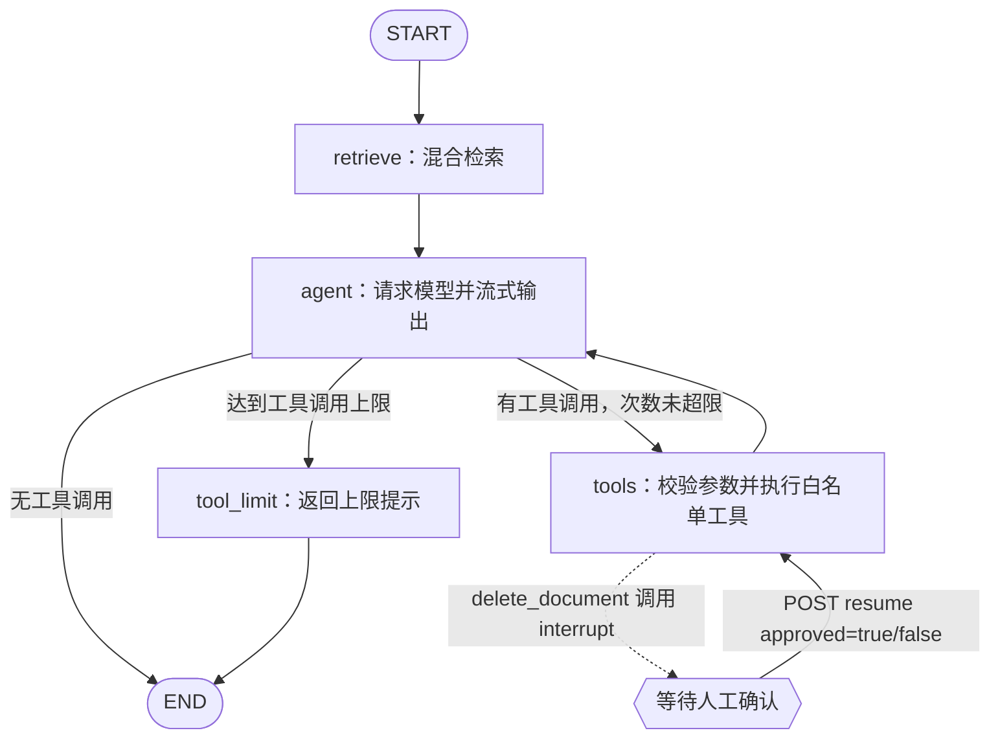

# V4 LangGraph 学习与代码导读

本文对应仓库当前的 V4 实现。目标是先读懂 LangGraph 的基本概念，再沿着一次真实请求追踪状态如何经过节点、条件边、工具调用、Checkpoint 和中断恢复。

## 1. 推荐学习顺序

1. 先理解 `StateGraph`、State、Node 和 Edge：看官方 [Graph API 概览](https://docs.langchain.com/oss/python/langgraph/graph-api) 和 [Quickstart](https://docs.langchain.com/oss/python/langgraph/quickstart)。
2. 再读本项目的 [app/agent/state.py](../app/agent/state.py) 和 [app/agent/graph.py](../app/agent/graph.py)，把框架概念映射到项目代码。
3. 读 [app/agent/schemas.py](../app/agent/schemas.py)、[app/agent/tools.py](../app/agent/tools.py) 和 [app/llm/client.py](../app/llm/client.py)，理解 JSON Schema、工具参数校验和模型返回的工具调用。
4. 读 [app/main.py](../app/main.py) 与 [app/services/chat_service.py](../app/services/chat_service.py)，理解 PostgreSQL Checkpoint 如何初始化、如何为每个会话指定 `thread_id`，以及 API 如何读取图事件。
5. 最后读 [app/api/chat.py](../app/api/chat.py)、[app/schemas/chat.py](../app/schemas/chat.py)、[app/schemas/events.py](../app/schemas/events.py) 和 [static/js/app.js](../static/js/app.js)，追踪用户审批、SSE 和恢复请求。
6. 用 [tests/unit/test_agent_graph.py](../tests/unit/test_agent_graph.py) 验证工作流。测试用假的模型和检索器，不需要 DeepSeek API Key 或 PostgreSQL。

官方概念文档：[LangGraph 概览](https://docs.langchain.com/oss/python/langgraph/overview)、[Persistence](https://docs.langchain.com/oss/python/langgraph/persistence)、[Interrupts](https://docs.langchain.com/oss/python/langgraph/interrupts)、[Streaming](https://docs.langchain.com/oss/python/langgraph/streaming)。

V4 当前依赖范围为 `langgraph>=1.2,<2`、`langgraph-checkpoint-postgres>=3,<4` 和 `psycopg[binary]>=3.2`。本次环境安装版本分别为 LangGraph 1.2.17、Postgres Checkpoint 3.2.0、psycopg 3.3.6。`version="v2"` 流事件格式由 LangGraph 在 `astream()` 中提供。

## 2. V4 工作流总览



`retrieve -> agent` 是确定性步骤；模型通过工具调用决定是否进入 `tools`。工具执行后，工具结果会追加到消息中，再回到 `agent` 生成最终回答。删除文档会在 `tools` 节点内部暂停，外部确认后从同一位置恢复。

## 3. LangGraph 核心概念在本项目中的对应

| LangGraph 概念 | 本项目实现 | 作用 |
|---|---|---|
| State | `app/agent/state.py` 的 `AgentState` | 节点之间传递对话、查询、检索上下文、引用和工具轮次 |
| Node | `app/agent/graph.py` 中的 `retrieve_node`、`agent_node`、`tools_node`、`tool_limit_node` | 每个节点完成一类工作并返回 State 更新 |
| Edge | `app/agent/graph.py` 中的 `add_edge` | 指定固定执行顺序 |
| Conditional edge | `route_after_agent` + `add_conditional_edges` | 按模型是否请求工具、工具轮次是否达到上限选择下一节点 |
| Loop | `tools -> agent` | 把工具结果交回模型继续推理；轮次数受配置限制 |
| Checkpointer | `app/main.py` 创建的 `AsyncPostgresSaver` | 将同一会话的图状态写入 PostgreSQL，可跨进程重启读取 |
| `thread_id` | `app/services/chat_service.py` 的 `session_id` | 把图的 checkpoint 和项目会话一一对应 |
| Interrupt | `app/agent/tools.py` 的 `interrupt(...)` | 删除文档前保存状态并暂停，等待用户决定 |
| Resume | `Command(resume=...)` | 把用户确认结果送回原来的 `interrupt()`，继续执行暂停的节点 |
| Stream writer | `app/agent/graph.py` 的 `get_stream_writer()` | 把模型 token 作为 LangGraph 自定义事件发送给 API |

## 4. State：节点共享的数据

[app/agent/state.py](../app/agent/state.py) 定义了：

- `messages`：传给模型的消息数组。一次正常请求由数据库中已有的 user/assistant 历史和最新问题组成；工具循环时包含模型工具调用消息和工具结果。
- `question`：当前轮的用户问题，供检索节点使用，也供完成后写入会话记录。
- `context`：本轮检索出的原文分块，模型回答时用它作为证据；Agent 再次搜索后也会把新分块加进来。
- `citations`：与上下文对应的来源引用，最终通过 SSE 返回并存进业务消息表。
- `tool_rounds`：已完成的工具轮数，用来限制循环。

这些值使用普通 Python 字典、列表、数字和字符串，便于 checkpoint 序列化。项目没有把 Pydantic 对象或模型运行时对象放进 State。

`messages` 没有使用 `add_messages` reducer：每次新聊天由 `ChatService` 从业务会话表重新组装历史，因此图输入直接设置本轮完整消息列表，不会重复追加旧 checkpoint 中的消息。一次正在执行的图运行中，节点会返回完整的新列表；中断时，Saver 保存该轮消息和其它字段。会话历史的展示与最终对话仍以 `sessions/messages` 业务表为准。

## 5. 图如何构建，以及分支和循环如何工作

图都在 [app/agent/graph.py](../app/agent/graph.py) 的 `build_agent_graph()` 中定义：

1. `StateGraph(AgentState)` 声明图的状态类型。
2. `add_node()` 注册四个节点：`retrieve`、`agent`、`tools` 和 `tool_limit`。
3. `START -> retrieve -> agent` 是固定起始路径。
4. `agent` 通过条件边调用 `route_after_agent()`：
   - 最后一条模型消息没有 `tool_calls`：路由到 `END`。
   - 有工具调用且 `tool_rounds` 小于 `AGENT_MAX_TOOL_ROUNDS`：路由到 `tools`。
   - 有工具调用但已经达到上限：路由到 `tool_limit`，生成一条可读提示后结束。
5. `tools -> agent` 构成循环。工具结果以 `role="tool"` 消息写入 State，模型下一轮能看到结果。
6. `compile(checkpointer=checkpointer)` 编译图，并为它挂上持久化器。

默认最多执行 5 轮工具调用，可用 `AGENT_MAX_TOOL_ROUNDS` 配置，范围 1 到 12。每轮只执行一个模型工具调用；如果模型返回多个调用，本轮会返回参数化错误提示而不执行它们。这样方便学习和审计，也降低一次响应触发多项副作用的风险。

## 6. 工具与 JSON Schema 参数

### Schema 在哪里定义

[app/agent/schemas.py](../app/agent/schemas.py) 用 Pydantic 定义三个工具的输入：

- `SearchKnowledgeArguments`：要求非空 query，`top_k` 限制在 1 到 10。
- `ListDocumentsArguments`：无参数对象。
- `DeleteDocumentArguments`：要求格式受限的文档 ID。

[app/agent/tools.py](../app/agent/tools.py) 的 `openai_tool_schemas()` 对每个 Pydantic 类调用 `model_json_schema()`，生成模型 API 所需的 function tool schema。模型返回参数后，`execute_tool()` 再调用 `model_validate_json()` 做本地校验。**JSON Schema 告诉模型有哪些参数，Pydantic 校验才是执行前的服务端边界**；不依赖模型一定生成正确参数。

### 工具调用经过哪些文件

1. `app/llm/client.py` 把工具定义发给 DeepSeek，逐块接收流式内容和工具参数片段。工具参数可能跨多个流式块，因此按工具索引拼接。
2. `app/agent/graph.py` 的 `agent_node` 把最终 tool call 写入 assistant 消息，同时通过 `get_stream_writer()` 转发文本 token。
3. `route_after_agent()` 判断是否转入工具节点。
4. `tools_node()` 解析工具名及原始 JSON 参数，调用 `execute_tool()`。
5. `execute_tool()` 只允许 `TOOL_DEFINITIONS` 中列出的工具；未知工具、无效 JSON 或不符合 Pydantic schema 的参数不会进入业务函数。
6. 工具结果变成 `role="tool"` 消息，图沿 `tools -> agent` 返回模型节点。

`search_knowledge` 调用 V3 的 `VectorRetriever`；`list_documents` 调用文档仓储；`delete_document` 删除前必须中断等待确认。这个版本保留现有检索实现，没有把 V3 替换成 LlamaIndex 或 LangChain 的 Retriever。

DeepSeek 工具请求显式关闭 thinking mode，保持 OpenAI 兼容工具调用的消息流程简单；模型流中的工具参数仍然会由应用端校验。相关 API 细节参见 [DeepSeek Tool Calls 文档](https://api-docs.deepseek.com/guides/tool_calls/) 和 [Chat Completions API](https://api-docs.deepseek.com/api/create-chat-completion/)。

## 7. Checkpoint：状态如何保存

### 初始化位置

[app/main.py](../app/main.py) 的 FastAPI lifespan 在服务启动时：

1. 将 SQLAlchemy 的 `postgresql+asyncpg://` 连接地址转换成 psycopg 使用的 `postgresql://` 地址。
2. 创建 `AsyncPostgresSaver`。
3. 执行 `await checkpointer.setup()`，首次运行时创建 LangGraph 管理的 checkpoint 表。
4. 把 saver 传给 `build_agent_graph()`。
5. 应用关闭时退出 saver 上下文。

Checkpoint 表与应用的 documents、chunks、sessions、messages 表共用同一 PostgreSQL 数据库，但它们由 LangGraph 的 saver 单独管理，不通过项目 Alembic migration 管理。测试时 [tests/conftest.py](../tests/conftest.py) 使用 `InMemorySaver`，因此测试无需 PostgreSQL。

### 用 `thread_id` 找到状态

[app/services/chat_service.py](../app/services/chat_service.py) 用 `{"configurable": {"thread_id": session_id}}` 调用图。新建的 `session_id` 会作为稳定的 `thread_id`；同一个会话后续执行或恢复，都传同一个 ID。不同会话因此拥有相互隔离的 checkpoint。

Checkpoint 记录图节点执行后的 State，用于从故障或人工中断处继续。业务消息表仍用于会话列表、历史展示和已完成对话；未完成审批的本轮会在恢复成功后才写入业务消息表。

## 8. Interrupt：删除前暂停与恢复

### 暂停

[app/agent/tools.py](../app/agent/tools.py) 在 `delete_document` 分支先调用：

```python
decision = interrupt(
    {
        "action": "delete_document",
        "document_id": arguments.document_id,
        "message": "...",
    }
)
```

LangGraph 把这个 JSON payload 暴露给调用方，并通过 checkpointer 保存当前 State。此时不会删除文档。

### 暴露给前端

[app/services/chat_service.py](../app/services/chat_service.py) 读取 `astream(..., stream_mode=["custom", "updates"], version="v2")` 的更新事件。如果更新里出现 `__interrupt__`，服务将它转成 SSE `approval_required` 事件。事件结构在 [app/schemas/events.py](../app/schemas/events.py)。

[app/api/chat.py](../app/api/chat.py) 提供两个接口：

- `GET /api/chat/{session_id}/pending`：查询此会话是否存在待确认动作。前端切换会话时会检查它，以便网页重载或应用重启后找回等待中的审批。
- `POST /api/chat/{session_id}/resume`：请求体为 `{"approved": true}` 或 `{"approved": false}`，恢复 SSE 流。

[static/js/app.js](../static/js/app.js) 接到 `approval_required` 后显示确认框；恢复会话时也会先查询 pending 接口。批准或拒绝都会调用 resume 接口。

### 恢复与副作用顺序

服务先检查会话的 checkpoint 中确实存在 interrupt，然后用**原来的** `thread_id` 调用：

```python
Command(resume={"approved": approved})
```

这会把响应作为 `interrupt()` 的返回值。LangGraph 会从被中断节点的开头重新运行，所以 `delete_document` 工具把删除操作放在 `interrupt()` 之后：重跑时会重新询问并拿到 resume 值，只有 `approved is True` 才会调用 `retriever.remove_document()`。用户拒绝时返回工具结果并继续 Agent 对话，不执行删除。

## 9. 从网页请求到图执行的完整路径

1. `static/js/app.js` 向 `POST /api/chat/stream` 发送问题和 `session_id`。
2. `app/api/chat.py` 调用 `ChatService.stream()` 并返回 SSE。
3. `ChatService` 读取业务历史，给图传入完整 `messages`、当前 `question` 和会话 `thread_id`。
4. `app/agent/graph.py` 先检索，再调用模型；图的自定义 token 事件变成 SSE `token`，检索更新变成 SSE `retrieval`。
5. 图没有中断时，Service 从 checkpoint 最终状态读出回答和引用，将 user/assistant 对写到业务表，再发送 SSE `completed`。
6. 图中断时，发送 `approval_required` 并暂停，不写入“已完成”的业务消息。用户确认后，使用同一会话 ID 恢复图；完成后再保存对话。

因此，LangGraph 管的是**执行状态和流程恢复**；业务仓储管的是**会话和文档数据**。两类持久化职责不同。

## 10. 怎样验证和练习

```powershell
.\.venv\Scripts\python.exe -m pytest tests\unit\test_agent_graph.py -q
```

测试文件包含三个场景：

1. 检索节点把上下文和引用放入 State，Agent 使用该上下文回答。
2. Agent 请求 `search_knowledge`，图走 `agent -> tools -> agent`，第二次模型调用读到工具结果。
3. Agent 请求删除文档，首次调用返回 interrupt 且没有删除；用 `Command(resume=...)` 恢复后才执行删除。

读代码时可以尝试这些练习：

- 在 `schemas.py` 增加一个参数模型，在 `tools.py` 加实现，再观察 `openai_tool_schemas()` 如何自动生成 schema。
- 在 `graph.py` 为一个新节点加 `add_node` 和 edge，观察 State 字段如何在节点之间传递。
- 修改 `AGENT_MAX_TOOL_ROUNDS` 并用一个反复发起工具调用的假模型验证上限分支。
- 修改删除审批结果为拒绝，确认工作流仍恢复并结束，但仓储的删除方法没有被调用。
- 对比测试中的 `InMemorySaver` 和运行应用时的 `AsyncPostgresSaver`：前者适合单测，服务重启后状态丢失；后者把 checkpoint 留在 PostgreSQL。

## 11. 本次验证结果

| 检查 | 结果 |
|---|---|
| `ruff format --check .` | 通过：70 个文件已格式化 |
| `ruff check .` | 通过 |
| `mypy app tests` | 通过：63 个源文件无类型错误 |
| `pytest -q` | 通过：34 项测试 |
| `node --check static/js/app.js` | 通过 |
| `git diff --check` | 通过：无空白错误 |

这些测试使用内存 saver、模拟模型和模拟仓储；尚未连接真实 PostgreSQL 执行 `AsyncPostgresSaver.setup()`，也没有请求 DeepSeek API。运行环境已安装 LangGraph 1.2.17、Postgres Checkpoint 3.2.0 和 psycopg 3.3.6。

## 12. V4 的边界

- 这是单 Agent 的显式状态图；V5 才计划增加并行研究、审查和报告生成。
- 目前只有知识库检索、文档列表、带人工确认的文档删除三个白名单工具。
- 图状态里会保存本轮检索分块内容，以便中断后继续。Checkpoint 数据随会话增长，后续版本需要设计保留期和清理策略。
- 自动化测试用内存 saver 和假模型；本轮没有运行需要真实 PostgreSQL、下载模型或 DeepSeek API Key 的端到端测试。
- 项目在 `app/__init__.py` 中默认启用 `LANGGRAPH_STRICT_MSGPACK=true`，使 PostgreSQL saver 使用严格的 checkpoint 反序列化策略；部署环境可以通过显式环境变量覆盖该默认值。
